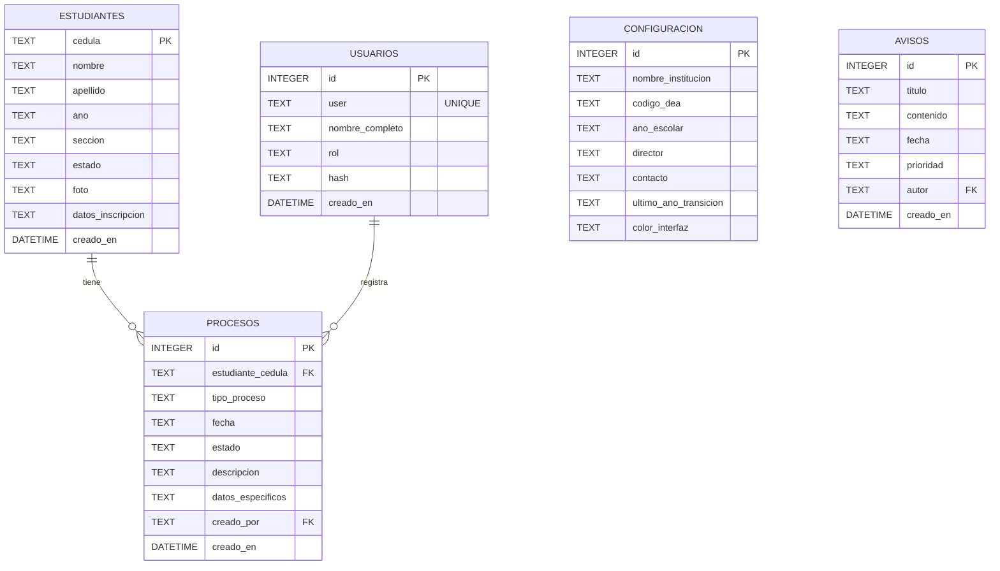

# Diagrama Entidad-Relación — Base de datos

**Proyecto:** Gestor de Procesos Institucionales (Escuela "Las Américas")
**Motor:** SQLite, archivo `database.sqlite` en la raíz del proyecto
**Origen del esquema:** `db.js` (creación de tablas y migraciones automáticas)

## Diagrama



## Entidades

| Entidad | Tabla | Llave primaria | Contenido |
| --- | --- | --- | --- |
| Estudiante | `estudiantes` | `cedula` (texto) | Datos personales y escolares, estado y foto. |
| Proceso | `procesos` | `id` autoincremental | Trámite asociado a un estudiante: tipo, fecha, estado y descripción. |
| Usuario | `usuarios` | `id` autoincremental | Cuenta de acceso: usuario, rol y contraseña cifrada con bcrypt. |
| Configuración | `configuracion` | `id` autoincremental | Un solo registro con los datos de la institución, el año escolar y el color de interfaz. |
| Aviso | `avisos` | `id` autoincremental | Comunicado institucional: título, contenido, prioridad y autor. |

## Relaciones

- **Estudiante → Procesos (1:N).** `procesos.estudiante_cedula` referencia a `estudiantes.cedula`. Un estudiante puede acumular muchos procesos y cada proceso pertenece a un estudiante. La cédula se usa como identificador natural del alumno, en lugar de un `id` numérico.
- **Usuario → Procesos (1:N).** `procesos.creado_por` guarda el usuario que registró el proceso. Un usuario puede registrar muchos procesos.
- **Usuario → Avisos (referencia débil).** `avisos.autor` conserva el nombre de quien publica el aviso, sin llave foránea.
- **Configuración y Avisos** no dependen de otras tablas: `configuracion` la lee toda la aplicación y `avisos` se muestra de forma independiente en el panel.

## Cómo se representa la cardinalidad en Mermaid

La sintaxis de una relación es `ENTIDAD_A <cardinalidad> ENTIDAD_B : "verbo"`. Los símbolos se leen del lado de la entidad a la que apuntan:

| Símbolo | Significado |
| --- | --- |
| `\|\|` | Exactamente uno |
| `o\|` | Cero o uno |
| `}\|--{\|` | Muchos (varios a ambos lados) |
| `o{` | Cero o muchos |

Por eso `ESTUDIANTES \|\|--o{ PROCESOS` se lee: *un proceso pertenece a exactamente un estudiante, y un estudiante puede tener cero o muchos procesos*.

Dentro de cada bloque de entidad, cada atributo se escribe como `tipo nombre [PK \| FK] "comentario"`; los tipos de SQLite (`TEXT`, `INTEGER`, `DATETIME`) se copian tal cual del `CREATE TABLE`.

## Notas del diseño

**Las relaciones son lógicas, no declaradas.** El esquema no incluye cláusulas `FOREIGN KEY` ni `REFERENCES`; SQLite no las imponen. Las relaciones las arma la capa de aplicación con `JOIN` al consultar (por ejemplo, `procesos` unido a `estudiantes` en `routes/rutas.js`), y el servidor valida que el estudiante exista antes de insertar el proceso.

**`procesos.datos_especificos` es un bloque JSON guardado como texto.** Permite que cada tipo de proceso almacene campos propios sin cambiar la tabla, a costa de que esos datos no sean consultables columna por columna.

**`estudiantes` concentra la planilla de inscripción completa.** Además de las columnas base, `db.js` agrega por migración los grupos de datos del estudiante, la madre, el padre y el representante, más las tallas de uniforme (39 columnas en total). En el diagrama se agrupan en `datos_inscripcion` para no saturar la lectura; el detalle está en la lista `columnasEstudiante` de `db.js`.

**`usuarios.hash` nunca es la contraseña en claro.** Se genera con bcrypt al crear el usuario.

## Cómo ver el diagrama

El bloque ` ```mermaid ` se renderiza automáticamente en GitHub y GitLab. Para previsualizarlo antes de subir:

- [mermaid.live](https://mermaid.live) — pegar el código en el editor.
- VS Code con la extensión *Markdown Preview Mermaid Support*, o la vista previa integrada de GitHub.
- `npx @mermaid-js/mermaid-cli -i diagramaentidadrelacion.md -o diagrama.svg` exporta a imagen si hay que entregarlo en otro formato.
